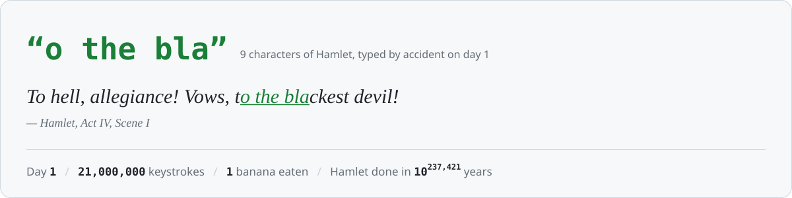
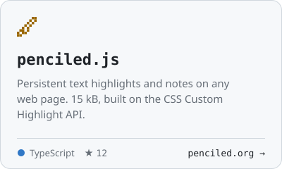
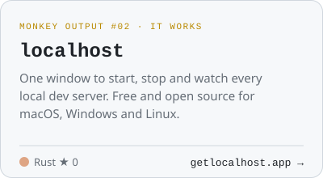
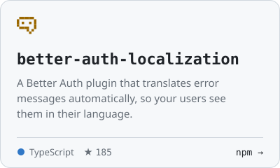

<!-- Generated by scripts/monkey.mjs. Edit the script, not this file. -->

<picture><source media="(prefers-color-scheme: dark)" srcset="assets/banner-dark.svg"></picture>

  <b>Hey, I'm Marcel.</b> Developer from Santos, Brazil 🇧🇷 
  I build all kinds of things: libraries, desktop apps, websites, even the occasional small game. 
  This profile is one of them. It's running an experiment right now.

###  The experiment

Give a monkey a typewriter and infinite time, and it will eventually type the complete works of Shakespeare. That's the [infinite monkey theorem](https://en.wikipedia.org/wiki/Infinite_monkey_theorem). I'm testing it.

Every day a GitHub Action gives my monkey **10,000,000 random keystrokes** and checks whether any of them landed on *Hamlet*. Here's how it's going:

<picture><source media="(prefers-color-scheme: dark)" srcset="assets/stats-dark.svg"></picture>

  <a href="https://github.com/marcellosso/marcellosso/issues/new?title=%F0%9F%8D%8C%20Feed%20the%20monkey&body=Here's%20a%20banana.%20Get%20typing.%20%F0%9F%90%92%0A%0A(Just%20hit%20**Create**.%20The%20monkey%20eats%20it%2C%20types%20a%20million%20keys%20and%20replies%20with%20what%20it%20wrote.)"><picture><source media="(prefers-color-scheme: dark)" srcset="assets/feed-dark.svg"></picture></a> 
  Each banana buys 1,000,000 extra keystrokes right away. The monkey replies with what it typed, and you join the wall below.

 <b>Banana donors</b>  

###  Things the monkey typed that actually work

<a href="https://www.penciled.org"><picture><source media="(prefers-color-scheme: dark)" srcset="assets/card-penciled-dark.svg"></picture></a>
<a href="https://www.getlocalhost.app"><picture><source media="(prefers-color-scheme: dark)" srcset="assets/card-localhost-dark.svg"></picture></a>
<a href="https://www.npmjs.com/package/better-auth-localization"><picture><source media="(prefers-color-scheme: dark)" srcset="assets/card-better-auth-localization-dark.svg"></picture></a>

###  Tools in the monkey's paws

###  Say hi

Questions about one of my projects? Open an issue on the repo. For anything else, email [marcel.losso@gmail.com](mailto:marcel.losso@gmail.com).

Last run 2026-10-27 00:38 UTC · Hamlet text from <a href="https://www.gutenberg.org/ebooks/1524">Project Gutenberg</a> · Fonts: Silkscreen, IBM Plex Mono, IM Fell English (OFL) · <a href="scripts/monkey.mjs">how it works</a>
